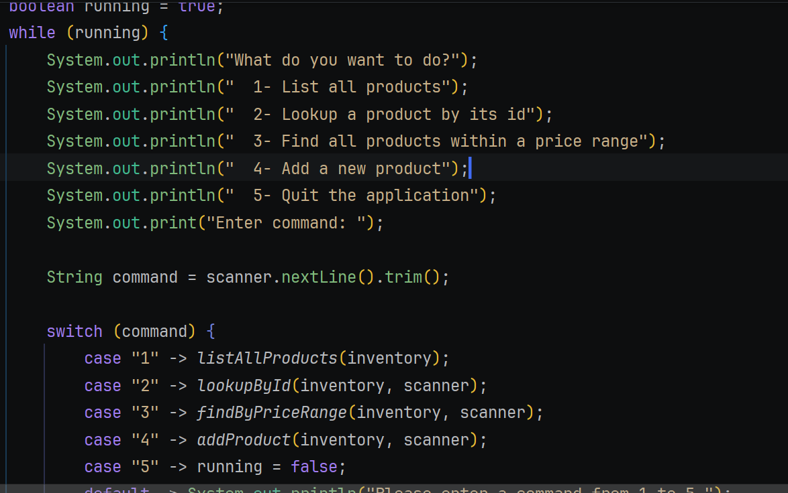
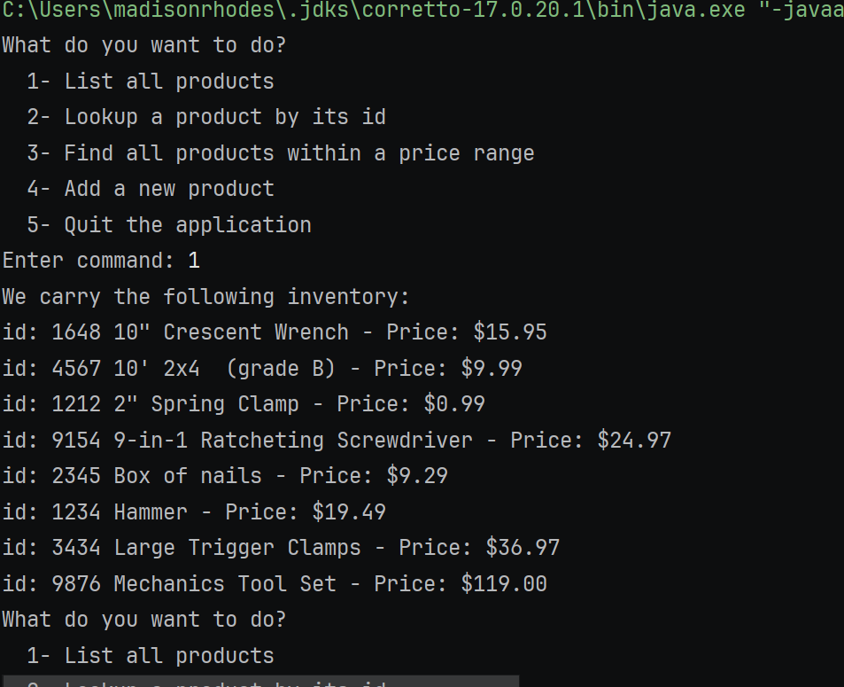
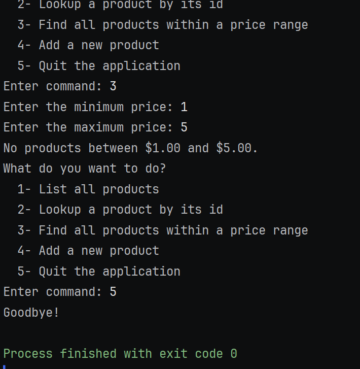

# Search Inventory
 A command-line app for a hardware store's inventory.
 It loads the products from inventory.csv and lets a user list them, look one up by id, find products in a price range, and add new ones.

### Features
- List every product, sorted by name
- Look up a product by its id

- Find all products within a minimum and maximum price

- Add a new product, which is saved to inventory.csv so it is still there next time

- Friendly messages for bad input, a missing id, or a missing file

### How to run it

1. Clone the repository and open it in IntelliJ
2. Make sure inventory.csv is in the project's top folder, next to pom.xml
3. Run StoreApp.java
4. Type a number from the menu, like 1 to list all products

### Interesting code

#### Why I like it

I like this section because it’s the part that holds the whole app together: one loop and one switch send every menu choice to its own method, so adding a new feature only takes one more case. 
It’s also interesting because a typo like "abc" just shows a friendly message and asks again, so the app keeps running until I choose to quit.

### How it works

- `running` starts as `true`, so the `while` loop repeats the menu. Choosing `5` sets it to `false`, which ends the loop and closes the app.
- `scanner.nextLine().trim()` reads what the user typed and removes extra spaces, so `" 2 "` still works.
- The `switch` sends each choice to its own method (`listAllProducts`, `lookupById`, and so on), so `main` stays short and each feature is easy to find.
- The `default` case catches anything that isn't 1 to 5 and asks again, so a typo doesn't crash the program.
- The command is read as text (`"1"`), not as a number. Typing a letter can't throw an error the way `Integer.parseInt` could.

### Screenshots

### Author
Lena Rhodes, Year Up Java Academy
